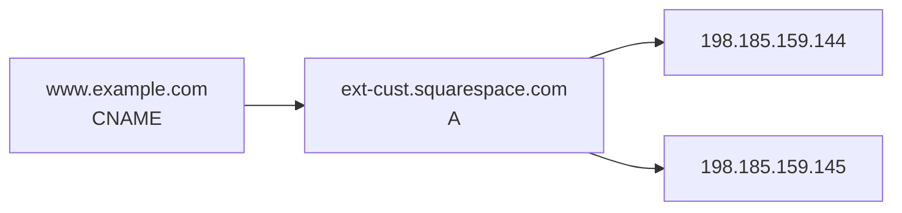

# /recon — site reconnaissance pack

Take a public URL and produce a self-contained folder describing the site, with capture fidelity scaling from "1-page vibe check" to "Docker-replayable forensic snapshot."

## Invocation

```
/recon <url>                                      → interactive (prompt for tier)
/recon <url> [dest]                               → non-interactive, default tier (design)
/recon <url> --mode <tier>                        → non-interactive, specified tier
/recon <url> --mode <tier> [dest]                 → non-interactive, specified tier + dest
/recon <url> [...overrides]                       → non-interactive, default tier + overrides
```

**Interactive vs non-interactive rule:** if the user passed *only* the URL, prompt for the tier. If they passed *anything else* (a dest, a `--mode`, an override flag), assume non-interactive and use sensible defaults for everything not specified.

If no URL is given, ask for one. Don't proceed without it.

### Override flags

| Flag | Effect |
|---|---|
| `--mode <tier>` | gist / design / pixel-perfect / offline / forensic |
| `--max-pages N` | override page-count cap (default 50) |
| `--depth N` | override crawl depth cap (default 3) |
| `--include <regex>` | extend the boundary — additionally allow URLs matching regex |
| `--exclude <regex>` | narrow the boundary — refuse URLs matching regex |
| `--ignore-robots` | ignore robots.txt (default: respect) |
| `--force-platform-root` | required to recon a bare platform root (e.g. `https://github.com`) |

## Capture tiers

Skill prompts you to pick if invoked with URL only. Default = `design`.

| Tier | Use case | Output | Time | Size |
|---|---|---|---|---|
| **`gist`** | "What's the vibe?" 1-pager | `GIST.md` only | ~10s | < 1 MB |
| **`design`** *(default)* | Designer hand-off | 5 .md + asset library | ~30s | 20–50 MB |
| **`pixel-perfect`** | Visual archive (online) | + all CSS/JS/fonts (CDN-linked) | ~2 min | 50–150 MB |
| **`offline`** | Self-contained snapshot | + every dep localized, URLs rewritten | ~5 min | 100–300 MB |
| **`forensic`** | Replay at original hostname | + `serve/` (Dockerfile, nginx.conf, certs) | ~5 min | 100–300 MB |

### Interactive tier prompt

When invoked with URL only, show:

```
What level of capture do you need?
  1. gist           — 1-page vibe summary, no asset library (~10s)
  2. design (default) — designer hand-off, light, ~30s
  3. pixel-perfect  — full visual snapshot, internet needed to view
  4. offline        — self-contained, opens with no internet
  5. forensic       — offline + container config to serve at original hostname

Pick [1-5, default 2]:
```

### Forensic-mode TLS prompt

If forensic is selected, additionally ask:

```
Forensic mode can serve over HTTP only, or with a self-signed TLS cert
matching the original hostname (you'd need to trust it locally to avoid
browser warnings).

  1. HTTP only (simpler)
  2. Self-signed TLS (closer to original)

Pick [1-2, default 1]:
```

## Output destination

The skill writes into a "scratch directory" — a parent folder where every recon pack lives. The exact path is configurable; the skill should never bake a specific user's home-path layout into its output.

### Resolving the scratch directory

Look these up in order; first match wins:

1. **Second positional arg** → use it verbatim (after `~`/`$HOME` expansion). This is the dest *folder* itself, not its parent — skip the slug step.
2. **`$AI_SCRATCH_DIR` env var** → use as the parent. Skill appends the slug.
3. **A user-level convention documented in `CLAUDE.md`** — if the user has set a personal "AI scratch directory" in their `~/.claude/CLAUDE.md` or a project-level `CLAUDE.md`, honor it. (Claude reads CLAUDE.md as context; the skill itself doesn't parse it.)
4. **Fallback** → `$HOME/ai-scratch/`. This is the only path the skill bakes in. Generic, neutral, works for anyone.

### Slug + date naming

When the skill chooses the dest folder name (cases 2–4 above), it always appends today's date in `YYYY-MM-DD` form, so re-runs don't collide and you can see captures over time:

- Single-tenant hosts → `<scratch>/<host>-<YYYY-MM-DD>/`
  e.g. `<scratch>/example.com-2025-03-14/`
- Multi-tenant platforms → `<scratch>/<host>-<flattened-path>-<YYYY-MM-DD>/`
  e.g. `<scratch>/github-acme-foo-2025-03-14/`

`www.` is stripped from the hostname. Path segments are joined with `-` and lowercased.

### Collision handling

If the resolved dest already exists and is non-empty (e.g. you're running again on the same day):

1. Print: *"That folder already exists from an earlier run. Here are some alternatives I can use instead:"*
2. Offer 2–3 alternative slugs that disambiguate by the parameters used in this run, e.g.:
   - `<slug>-<YYYY-MM-DD>-<mode>` if the mode differs (e.g. `…-offline` vs the existing `…-design`)
   - `<slug>-<YYYY-MM-DD>-<mode>-d<depth>-p<pages>` if multiple parameters differ
   - `<slug>-<YYYY-MM-DD>-<HHMM>` as a final fallback when everything else matches
3. Let the user pick, or accept the suggested alternative, or pass an explicit dest via the positional arg.

Never silently overwrite an existing non-empty dest.

## Bounding — when to stop crawling

Sites are not all the same. A small marketing site is fine to crawl whole; a single user/repo on a multi-tenant platform like `github.com` is not.

### Default boundary rules (in order)

1. **Same hostname only.** No subdomain spanning. `blog.example.com` and `www.example.com` are separate sites.
2. **Path-prefix lock derived from the input URL:**
   - Input has a path → lock to that prefix.
   - Input is just the root → allow the whole host.
3. **Platform detection.** For known multi-tenant platforms (table below), derive a tighter user-namespace boundary from the URL path. Refuse to escape it.
4. **Hard caps.** 50 pages, 3 levels deep. Override with `--max-pages` / `--depth`.
5. **Respect `robots.txt`** by default. Override with `--ignore-robots`.
6. **Off-host links never followed.** Off-host *assets* (CDN images, fonts, CSS) are pulled freely in `design+` tiers, but links to other hostnames (instagram.com, twitter.com from a marketing site) are never traversed.

### Platform-aware boundary table

Maintain in this skill so it's auditable. Key heuristic: identify the platform, then take the first one or two path segments as the user namespace.

| Input URL | Resolved boundary |
|---|---|
| `example.com` | whole host *(single-tenant)* |
| `example.com/menu` | whole host *(single-tenant)* |
| `github.com/octocat/hello-world` | `github.com/octocat/hello-world/*` |
| `github.com/octocat` | `github.com/octocat/*` *(all repos)* |
| `github.com/octocat/hello-world/issues/5` | back up to `github.com/octocat/hello-world/*` |
| `gitlab.com/someuser/some-project` | `gitlab.com/someuser/some-project/*` |
| `bitbucket.org/someuser/some-project` | `bitbucket.org/someuser/some-project/*` |
| `x.com/someone` | `x.com/someone/*` only |
| `twitter.com/someone` | `twitter.com/someone/*` only |
| `linkedin.com/in/someone` | `linkedin.com/in/someone/*` only |
| `linkedin.com/company/some-co` | `linkedin.com/company/some-co/*` only |
| `medium.com/@someone` | `medium.com/@someone/*` only |
| `substack.com/profile/...` / `*.substack.com` | that profile's namespace only |
| `dev.to/someone` | `dev.to/someone/*` only |
| `youtube.com/@channelname` | `youtube.com/@channelname/*` only |
| `tiktok.com/@username` | `tiktok.com/@username/*` only |
| `instagram.com/username` | `instagram.com/username/*` only |
| `facebook.com/pagename` | `facebook.com/pagename/*` only |
| `behance.net/username` | `behance.net/username/*` only |
| `dribbble.com/username` | `dribbble.com/username/*` only |
| `producthunt.com/products/some-product` | that product's namespace only |
| `reddit.com/r/some-sub` | `reddit.com/r/some-sub/*` only |

### Refuse-to-recon

- **Bare platform roots** (`https://github.com`, `https://x.com`, `https://linkedin.com`, `https://reddit.com`, `https://medium.com`, `https://substack.com`, etc.) — stop with: *"You gave me a platform root. Specify a user/repo/post, or pass `--force-platform-root` if you really mean it."*
- **Login-walled URLs** — if the entry returns 401/403 or redirects to a login page, stop and tell the user.

### Per-tier asset/link policy

| | `gist` | `design` | `pixel-perfect` | `offline` | `forensic` |
|---|---|---|---|---|---|
| HTML pages walked | 1–2 | up to 50 | up to 50 | up to 50 | up to 50 |
| robots.txt | respect | respect | respect | respect | respect |
| Off-host *assets* (images/CSS/JS/fonts) | no | images only | yes | yes + localized | yes + localized |
| Off-host *links* followed | never | never | never | never | never |

## Preflight summary (always shown, all tiers)

Before any download, print the resolved plan and ask Proceed:

```
URL:           https://github.com/octocat/hello-world
Hostname:      github.com  (detected platform: GitHub multi-tenant)
Boundary:      github.com/octocat/hello-world/*
Mode:          design
Page cap:      50
Depth cap:     3
robots.txt:    respected
Dest:          <scratch>/github-octocat-hello-world-2025-03-14/

Proceed? [Y/n]
```

If the user declines, exit cleanly and suggest override flags.

## Output layout

```
<dest>/
├── README.md                ← cover sheet: what's in here, mode used, links to siblings
├── GIST.md                  ← only in `gist` tier
├── DESIGN.md                ← brand brief (design+ tiers)
├── TECHSTACK.md             ← tech fingerprint (design+ tiers)
├── DNS.md                   ← DNS records + CNAME diagrams (design+ tiers)
├── WALK.md                  ← page-by-page sitemap walk (design+ tiers)
├── Makefile                 ← `make dev` to serve the capture locally (design+ tiers)
├── <hostname>/              ← scraped HTML pages
├── assets/
│   ├── logo/                ← favicon + header logo
│   ├── images/              ← all distinct images at largest size
│   ├── css/                 ← only in pixel-perfect+
│   ├── js/                  ← only in pixel-perfect+ (analytics omitted)
│   └── fonts/               ← only in pixel-perfect+
└── serve/                   ← only in forensic
    ├── Dockerfile
    ├── nginx.conf
    ├── docker-compose.yml
    ├── certs/               ← only if self-signed TLS chosen
    ├── hosts.entry
    └── README.md            ← how to run, what works, what doesn't
```

## Process

### Step 0 — Parse args, resolve boundary, prompt if interactive

1. Validate URL.
2. Detect platform from hostname; resolve boundary per the table above.
3. If invoked with URL only → interactive tier prompt; else apply defaults + flags.
4. Resolve dest (default slug from hostname/path; or use the second positional arg).
5. Print preflight summary; wait for Proceed.

### Step 1 — Set up dest

Resolve the dest using the rules in *Output destination* (positional arg → `$AI_SCRATCH_DIR` → user's CLAUDE.md preference → `$HOME/ai-scratch/`), then append `<slug>-<YYYY-MM-DD>` when the skill is choosing the folder name itself.

```bash
TODAY=$(date +%Y-%m-%d)
SCRATCH="${AI_SCRATCH_DIR:-$HOME/ai-scratch}"
SCRATCH="${SCRATCH/#\~/$HOME}"

if [[ -n "$2" ]]; then
  DEST="${2/#\~/$HOME}"            # explicit dest from positional arg
else
  DEST="$SCRATCH/${SLUG}-${TODAY}"  # default: <scratch>/<slug>-<date>
fi

# Collision: if non-empty, ask the user — never overwrite silently.
if [[ -d "$DEST" && -n "$(ls -A "$DEST" 2>/dev/null)" ]]; then
  # offer parameter-suffixed alternatives, e.g. "${DEST}-${MODE}"
  : # interactive resolution per Output destination section
fi

mkdir -p "$DEST/assets/images" "$DEST/assets/logo"
# pixel-perfect+ also: assets/css assets/js assets/fonts
# forensic also:       serve/ serve/certs
cd "$DEST"
```

### Step 2 — Mirror the HTML

```bash
WGET_BASE=(--mirror --convert-links --adjust-extension --page-requisites
  --no-parent --timeout=30 --tries=2
  --reject "*.mp4,*.webm,*.mov,*.zip,*.dmg,*.exe"
  --user-agent="Mozilla/5.0 (Macintosh; Intel Mac OS X 10_15_7) AppleWebKit/537.36 (KHTML, like Gecko) Chrome/120.0 Safari/537.36"
  --include-directories="$BOUNDARY_PATH"  # only when path-prefix lock applies
  -Q $((MAX_PAGES * 2))m  # rough byte cap, soft
  --level "$DEPTH")

# Respect robots.txt unless --ignore-robots:
[[ -z "$IGNORE_ROBOTS" ]] || WGET_BASE+=(-e robots=off)

wget "${WGET_BASE[@]}" "$URL"
```

Stop after `MAX_PAGES` HTML pages — count `*.html` files in the output directory.

### Step 3 — SPA sanity check

If the largest fetched HTML page has < 500 chars of visible text after stripping `<script>`/`<style>`/`<noscript>` and tags, the site is JS-rendered. **Tell the user; offer to continue** (asset library may still be useful).

### Step 4 — Pull off-host assets at full resolution

`wget --page-requisites` only stays on-host. Modern sites serve images/fonts/CSS/JS from CDNs.

Process for each asset class:

1. `grep -hoE 'https://[^"]+\.(jpe?g|png|gif|webp|svg)' <pages>` → unique image URLs.
2. Strip query strings to dedupe by base path.
3. Re-download each at the highest size variant the CDN exposes:
   - **Squarespace** (`images.squarespace-cdn.com`): append `?format=2500w`
   - **Shopify** (`cdn.shopify.com/...?width=N`): drop `width` param
   - **WordPress / generic**: as-is
4. Save into `assets/images/` using basename of the URL path.

**Tier-gated additions:**

- `pixel-perfect+`: also pull all referenced CSS, JS (skip analytics — see omit list), fonts (`assets/css/`, `assets/js/`, `assets/fonts/`).
- `offline+`: after pulling, rewrite all HTML/CSS to point at local paths. `httrack` does this better than wget for recursive `@import` / `url()` chains; if available, prefer it for offline. Otherwise post-process with sed.
- All tiers: pull `<link rel="apple-touch-icon">` (preferred) or `<link rel="icon">` → `assets/logo/favicon.<ext>`. Pull any `` inside the first `<header>`/`<nav>` whose src or alt contains "logo" → `assets/logo/`.

### Step 5 — Detect tech stack (TECHSTACK.md)

Run a Wappalyzer-style fingerprint pass against:
- HTTP response headers (`Server`, `Via`, `X-Powered-By`, `X-Generator`)
- HTML `<meta name="generator">`
- Inline script src URLs
- Asset host patterns
- Cookie names
- Footer text patterns

Categories to detect (each with detection signal recorded):

- **CMS / builder** — Squarespace, WordPress, Webflow, Shopify, Hugo, Jekyll, Ghost, Wix
- **Frontend framework** — React, Vue, Angular, Svelte, Next.js, Gatsby, jQuery, vanilla
- **CSS approach** — Tailwind, Bootstrap, framework-CSS, custom
- **Webfonts** — provider + families + weights (Google Fonts, Adobe Fonts, self-hosted)
- **Analytics & tracking** — GA4, Plausible, Fathom, Mixpanel, Heap, Hotjar, FullStory
- **Tag managers** — GTM, Segment
- **Marketing / CRM widgets** — HubSpot, Mailchimp, Klaviyo, Drift, Intercom, Crisp
- **E-commerce** — Shopify, Square, WooCommerce, Squarespace Commerce
- **Payments** — Stripe, PayPal, Square, Apple Pay
- **Forms** — Squarespace, Formspree, Typeform, Tally, custom
- **Maps** — Google Maps, Mapbox
- **Video embeds** — YouTube, Vimeo, Wistia, self-hosted
- **Booking** — Calendly, Acuity, Square Appointments
- **A/B testing** — Optimizely, VWO
- **CDN** — CloudFront, Cloudflare, Fastly, Squarespace, Shopify (from `Server:`/`Via:`/asset hosts)
- **Hosting / server** — `Server:` response header

Each entry: name + detection signal (auditable).

### Step 6 — DNS lookups (DNS.md)

For both apex and `www.` subdomain:

```bash
dig +short A    "$DOMAIN"
dig +short AAAA "$DOMAIN"
dig +short CNAME "$DOMAIN"
dig +short MX   "$DOMAIN"
dig +short NS   "$DOMAIN"
dig +short TXT  "$DOMAIN"
dig SOA "$DOMAIN" +short
dig CAA "$DOMAIN" +short
whois "$DOMAIN" 2>/dev/null | head -50
```

Walk the CNAME chain until terminal A record. Render two diagrams: Mermaid (rich rendering on GitHub) **and** ASCII (terminal-friendly diffs).

**Mermaid:**

````markdown

````

**ASCII fallback:**

```
www.example.com  ──CNAME──▶  ext-cust.squarespace.com  ──A──┬─▶ 198.185.159.144
                                                            └─▶ 198.185.159.145
```

Cross-reference TXT records against TECHSTACK detections — verification records (`google-site-verification`, `MS=`, `klaviyo-domain-verify`, etc.) are excellent confirmation of which services are actually configured.

### Step 7 — Walk the pages (WALK.md)

For every fetched page:
- URL (relative)
- HTTP status (200 / 3xx → final URL / 4xx / 5xx)
- `<title>`
- 1–2 sentence summary of sections (e.g. "Hero + 3 pillars + testimonials")
- Image count
- Outgoing nav links (off-host, captured but not followed)

Group by:
- Top-level navigation (links found in `<header>`/`<nav>`)
- Footer-only links
- Deeper pages discovered
- Skipped (with reason: 401, off-host, non-HTML, robots disallow)

### Step 8 — Write DESIGN.md (the brand brief)

Use this structure (skimmable, table-heavy, no marketing fluff):

```markdown
# <Brand Name> — Design Brief

[1-paragraph framing]

## Brand snapshot
| Attribute | Value |  (name, tagline, founded, concept, tone, audience)

### Voice samples
[block quotes — verbatim]

### Pull quotes / testimonials (if present)

## Locations / Contact (if applicable)

## Page-by-page brand notes
[curated, not exhaustive — for exhaustive list see WALK.md]

## Image asset notes
[naming patterns, photoshoot vs casual vs recycled stock — flag suspicious assets]

## Suggestions worth flagging in a design pitch
[bugs, gaps, missing brand-kit pieces, low-hanging fruit]
```

**Tone**: skimmable, table-heavy, no marketing fluff. Quote real copy verbatim. Flag bugs (broken `<title>`, missing OG, recycled stock). Don't pad. Be honest when you can't extract something — say "color palette not captured, eyedrop from photos" rather than guessing.

### Step 9 — Write README.md (cover sheet, ~30 lines)

```markdown
# <Brand> — recon pack

Source: <url>
Captured: <YYYY-MM-DD>
Mode: <tier>
Boundary: <resolved boundary>
Pages walked: <N>

## Files in this pack

- **DESIGN.md** — brand brief / designer hand-off
- **TECHSTACK.md** — technologies detected on the source site
- **DNS.md** — DNS records, CNAME chain, registrar info
- **WALK.md** — page-by-page sitemap walk
- **<hostname>/** — captured HTML
- **assets/** — images, logo (and CSS/JS/fonts in pixel-perfect+)
- **Makefile** — `make dev` to serve the capture at http://127.0.0.1:8765/
- **serve/** — only present in forensic mode; see serve/README.md

## View it

```sh
make dev    # serves the captured HTML at http://127.0.0.1:8765/
make open   # opens the homepage in your default browser
make stop   # kills the server
```

## Hand-off notes

- Designers → start with DESIGN.md
- Engineers → start with TECHSTACK.md and DNS.md
- Reviewers → WALK.md is the index
```

### Step 10 — Write Makefile (design+ tiers)

All tiers that capture HTML (`design`, `pixel-perfect`, `offline`, `forensic`) ship a Makefile so the user can `cd <dest> && make dev` and immediately see the capture in a browser, without having to remember which subdirectory holds the HTML or what port to pick. `gist` skips this step (no HTML to serve).

Substitute `<hostname>` with the actual mirrored hostname directory at write time. The same template works for all four tiers — `make docker` self-detects whether `serve/` is present (forensic only).

```makefile
# Recon pack — local viewer. Generated by /recon at capture time.
#
# Quick start:
#   make dev      start a static HTTP server (default: http://127.0.0.1:8765/)
#   make open     open the homepage in your default browser
#   make stop     kill any server on $(PORT)
#   make docker   (forensic only) run the docker compose stack in serve/
#   make help     show this list
#
# Override port or bind address:
#   make dev PORT=9000 HOST=0.0.0.0

PORT ?= 8765
HOST ?= 127.0.0.1
ROOT := <hostname>
URL  := http://$(HOST):$(PORT)/

.DEFAULT_GOAL := help
.PHONY: help dev run serve open stop docker

help: ## show available targets
	@awk 'BEGIN{FS=":.*##"} /^[a-zA-Z_-]+:.*##/ {printf "  \033[1m%-8s\033[0m %s\n", $$1, $$2}' $(MAKEFILE_LIST)

dev: ## start a static HTTP server pointing at the captured HTML
	@echo "Serving $(ROOT)/ at $(URL)"
	@echo "Press Ctrl+C to stop."
	@cd $(ROOT) && python3 -m http.server $(PORT) --bind $(HOST)

run: dev   ## alias for dev
serve: dev ## alias for dev

open: ## open the captured homepage in your default browser
	@if command -v open >/dev/null; then open $(URL); \
	elif command -v xdg-open >/dev/null; then xdg-open $(URL); \
	else echo "Open $(URL) manually."; fi

stop: ## kill any process listening on $(PORT)
	@pid=$$(lsof -ti tcp:$(PORT) 2>/dev/null); \
	if [ -n "$$pid" ]; then kill $$pid && echo "killed pid $$pid on :$(PORT)"; \
	else echo "nothing listening on :$(PORT)"; fi

docker: ## (forensic only) bring up the docker compose replay stack in serve/
	@if [ -d serve ]; then cd serve && docker compose up; \
	else echo "No serve/ — this pack wasn't captured at forensic tier."; exit 1; fi
```

**Caveats to mention to the user once the server is up** (do this in the Closing summary, not in the Makefile itself):

- `design` and `pixel-perfect` tiers still depend on the live internet for off-host assets — pages will look right only with a network connection, and embedded trackers/analytics in the captured HTML *will* fire.
- `offline` tier has had its asset URLs rewritten to local paths, so it works disconnected.
- `forensic` tier serves over plain `python3 -m http.server` with `make dev` (quick check) or via the original-hostname Docker stack with `make docker` (full replay).

### Step 11 — Forensic-mode `serve/`

```
serve/
├── Dockerfile             # FROM nginx:alpine; COPY ../<hostname> /srv/site
├── nginx.conf             # server_name <orig-host>; MIME types; trailing-slash; rewrites
├── docker-compose.yml     # exposes :80 (and :443 if TLS chosen)
├── certs/                 # only if self-signed TLS chosen
├── hosts.entry            # `127.0.0.1 <orig-host>` — paste into /etc/hosts to use
└── README.md              # how to run + what works / doesn't
```

`serve/README.md` must honestly state limitations:

- Forms won't POST anywhere.
- Search/CMS dynamic features won't work.
- TLS won't match the original cert; if HTTP-only, browsers may upgrade and warn.
- External scripts still try to phone home unless explicitly stripped.
- Cookies / session-bound content is captured as it appeared at scrape time, not interactively replayable.

Run instructions:

```bash
sudo sh -c "cat hosts.entry >> /etc/hosts"   # one-time
docker compose up                            # serves at original FQDN
# When done:
sudo sed -i '' "/<orig-host>/d" /etc/hosts   # macOS; remove the entry
```

### Step 12 — `gist` mode (special-cased)

Skip steps 4–11 (no HTML mirror, no asset library, no Makefile). Only:

1. Fetch home page + first navigated "about" link (if any).
2. Extract copy + voice fingerprint.
3. Lightweight tech sniff (1-line read, not full TECHSTACK).
4. Lightweight DNS sniff (1-line read, not full DNS.md).
5. Optionally screenshot the homepage to `gist.png` if `playwright` or a screenshot service is available.
6. Write **`GIST.md`** (only output) with this structure:

```markdown
# <Brand> — gist

Source: <url>
Captured: <YYYY-MM-DD>

## Vibe (2–3 sentences)
[audience, tone, vertical, what they sell]

## Voice fingerprint
[5 verbatim pull-quotes from the site — never paraphrase]

## Tech (1 line)
Squarespace · Roboto · GA4 · Cloudflare CDN

## DNS (1 line)
Squarespace-hosted · Google Workspace mail · Cloudflare nameservers

## Want a deeper recon?
For a full designer hand-off:  /recon <url> --mode design
For a self-contained snapshot: /recon <url> --mode offline
For a replayable container:    /recon <url> --mode forensic
```

## What to always omit

- Squarespace / Webflow / Shopify framework component CSS bundles (in `design` tier; included in `pixel-perfect+`)
- Tracking pixels and analytics scripts (in *all* tiers — never replay these)
- Lower-resolution variants of the same image (`?format=300w`, `500w`, `750w`, `1000w`)
- Source maps, `.map` files
- Large media (`.mp4`, `.webm`, `.mov`, `.zip`, `.dmg`)
- Login-walled paths (we can't reach them anyway)

Specifically tracking domains to exclude from any captured JS:

- googletagmanager.com, google-analytics.com, googletagservices.com
- facebook.net, connect.facebook.net
- hotjar.com, fullstory.com
- segment.com, segment.io
- mixpanel.com, heap.io, amplitude.com, plausible.io (the JS), fathom.com
- linkedin.com/insight, snapchat.com/scevent
- pixel.* and tracker.* hosts

## When NOT to use

- Sites that require login — wget can't reach gated content.
- JS-rendered SPAs with no SSR — wget gets a near-empty shell. Asset library may still be worth pulling; warn first.
- Anything you don't have a legitimate reason to scrape. Public marketing sites and the user's own properties are fine. Before scraping anything else (a competitor's gated product docs, a person's profile on a platform, etc.), confirm intent and respect robots.txt.

## Closing summary

After finishing, print:

- The dest folder path
- The capture mode used
- File count and disk size
- For `design+` tiers: the one-liner `cd <dest> && make dev` so the user can view the capture immediately, plus a brief reminder of the tier's caveats (live-internet dependency for `design`/`pixel-perfect`, trackers in captured HTML, etc.)
- For `design+` tiers: the top 3–5 items from DESIGN.md's "Suggestions worth flagging"
- For `forensic`: also surface the original-hostname replay path (`cd <dest>/serve && docker compose up`, plus the `/etc/hosts` line) — `make dev` is the quick check, `make docker` is the full replay

So the user can act on the most important findings without opening any of the .md files.
